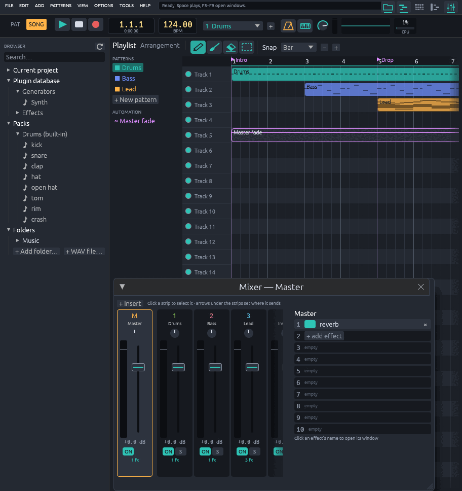
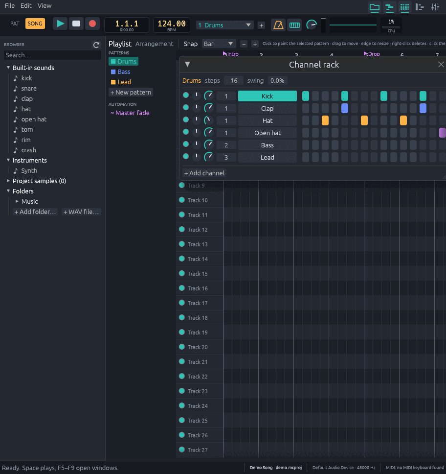
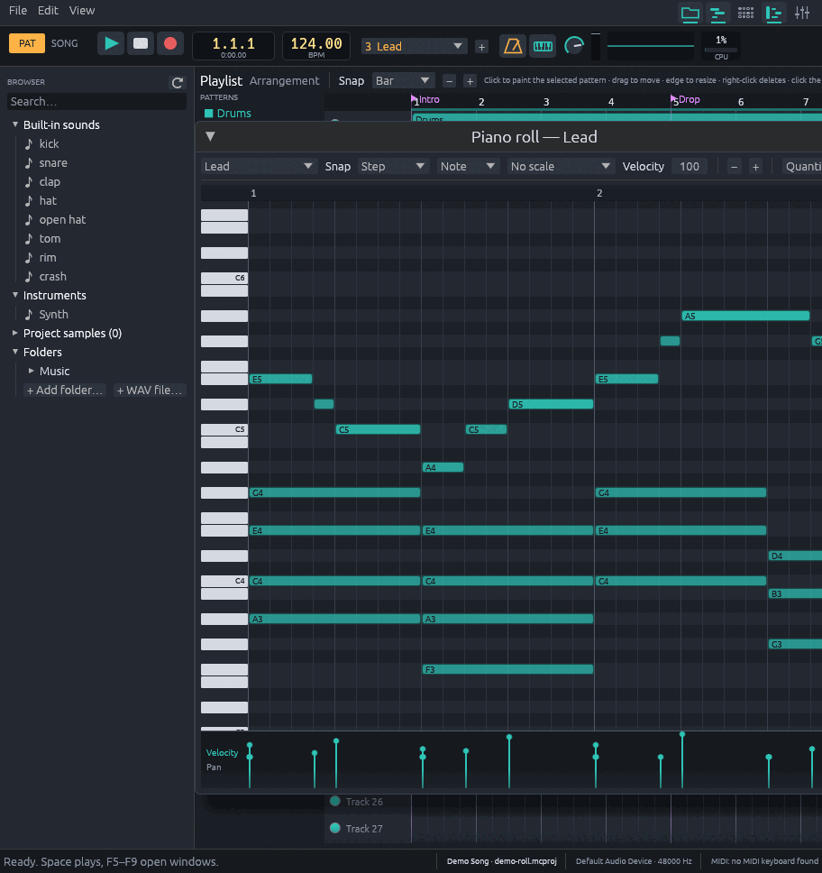
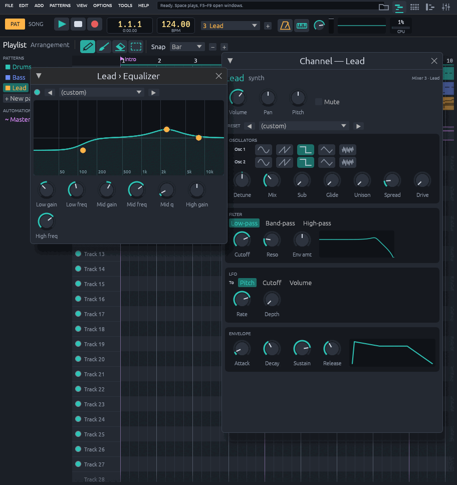

# MusicCraft

A clean-room, pure-Rust digital audio workstation with a pattern-based workflow:
channel rack, piano roll, playlist and mixer, with familiar default shortcuts.
Runs on Linux, macOS and Windows. Everything the app can do is a command, so it
can be driven from the GUI, scripts, the CLI, or an AI agent over MCP.



<table>
  <tr>
    <td></td>
    <td></td>
  </tr>
  <tr>
    <td align="center">Channel rack</td>
    <td align="center">Piano roll</td>
  </tr>
  <tr>
    <td colspan="2"></td>
  </tr>
  <tr>
    <td colspan="2" align="center">Synth editor and an effect window</td>
  </tr>
</table>

The screenshots show [`examples/demo-song.mcs`](examples/demo-song.mcs).

## Download

Grab the latest build from the [Releases page](https://github.com/bhimio1/musiccraft/releases):
Windows `.msi` or portable `.zip`, macOS `.dmg`, Linux `.flatpak` or portable
`.tar.gz`. Builds are not code-signed yet; see `docs/releasing.md` for first-launch
notes and how releases are made.

## Build and run

```sh
cargo run --release -p musiccraft-app              # the desktop app
cargo run --release -p musiccraft-app -- song.mcproj
```

Linux needs the ALSA development package (`alsa-lib` / `libasound2-dev`).

Options: `--empty` (no starter drum kit), `--keymap <file>`, `--open
channel_rack,piano_roll,playlist,mixer,browser`.

## Using it

| Key | Action |
| --- | --- |
| Space | Play / stop |
| L | Pattern / song mode |
| F5 / F6 / F7 / F9 | Playlist / channel rack / piano roll / mixer |
| F4, Plus, Minus | New / next / previous pattern |
| Ctrl+Z, Ctrl+Y | Undo / redo |
| Ctrl+S, Ctrl+O, Ctrl+R | Save / open / export WAV |
| Ctrl+M, Ctrl+E, Ctrl+T | Metronome / record / typing keyboard |
| F10 | Settings (audio device, buffer, MIDI port, scale, folders) |

Hover any control and the hint bar at the top says what it does.

- **Tools**: the playlist and piano roll have draw, paint, delete and select
  tools (pencil, brush, eraser, box) at the top left; the piano roll adds a
  mute tool. The piano roll's Tools
  menu strums, humanizes, makes legato, chops, glues, flips, snaps to a scale
  and arpeggiates; slide notes glide from the note before. The rack's
  right-click menu fills every 2/4/8 steps and shifts steps.
- **Instruments**: synth (three oscillators, unison, sub, drive, filter
  types, LFO, presets), FM synth (4 operators), keys (piano, e-piano, organ),
  additive synth, granular sampler, drum synth (kick, snare, hat, tom, clap),
  16-pad drum kit, plucked string, layer (one channel plays several), sampler
  with loop slicing, and CLAP plugins. Every channel has an arpeggiator.
- **Playlist** (main workspace): paint patterns, automation or audio clips;
  click, Shift+click or Ctrl+drag to select; drag to move or resize; Delete,
  Ctrl+B duplicate. Click the ruler to seek, Shift+drag it to set a loop,
  right-click it for markers.
- **Channel rack**: click steps; knobs for pan and volume (double-click resets);
  click a channel name for its settings. The synth has presets, two
  oscillators with unison and spread, sub, drive, low/band/high-pass filter
  with a live curve, an LFO and an envelope; melodic channels show a mini
  piano roll.
- **Piano roll**: click to draw (single notes or chords), drag to move, drag the
  right edge to resize, right-click (or right-drag across several) to delete;
  selection with copy, paste, Ctrl+B and arrow keys; scale highlighting; other
  channels' notes show as ghost notes. Notes can be slides, portamento or
  muted, carry a colour, and have per-note release, fine pitch and Mod X/Y
  (filter cutoff and resonance), edited in the event lane at the bottom
  alongside velocity and pan.
- **Mixer** (F9, floating): faders with a dB curve, pan, on/solo, ten effect
  slots, sends via the arrows under each strip. 35 built-in effects: filter,
  auto filter, vowel filter, 3-band, graphic and parametric EQ, bass boost,
  delay, multi-tap delay, stutter, reverb, convolution reverb (load an impulse
  file or pick a generated room), chorus, phaser, flanger, ring modulator,
  frequency shifter, pitch shifter, pitch corrector (snap a voice to a key and
  scale), tuner, vocoder, compressor and multiband
  compressor (sidechain), limiter, noise gate, transient shaper, trance gate,
  auto-pan, stereo tool, DC remover, distortion, overdrive, soft clipper,
  waveshaper and bitcrusher. Click an effect to open its window: presets, and
  a graph you can drag (EQ points, crossovers, compressor knee, delay taps…).
  View → Spectrum analyzer (or click the toolbar scope) shows the master
  output by frequency. `docs/builtin-coverage.md` compares the built-ins with
  a typical pattern-based DAW's stock plugins.
- **Automation**: right-click any knob or fader → Create automation clip;
  double-click the clip to edit its curve.
- **Browser**: current project, plugin database (generators and effects),
  packs and your folders, with search; click previews,
  double-click adds, drag onto the rack (new channel) or the playlist (audio
  clip).
- **Recording**: REC + playing records a MIDI or typing keyboard into the
  pattern; with File → Record audio input, song-mode takes become audio clips.
- **Export**: WAV (16/24/32f), FLAC (16/24), or one stem per mixer insert.
- **Plugins (CLAP)**: instruments and effects from `~/.clap`, `/usr/lib/clap`
  and `CLAP_PATH` show up in the browser, the rack's add menu and mixer slots.
  Each gets a parameter panel and can open its own window; parameters and
  state are saved in the project and exports render them. Tested with
  Surge XT and LSP plugins.

Built-in sounds (`builtin:kick`, `snare`, `clap`, `hat`, `open_hat`, `tom`,
`rim`, `crash`) are synthesized at start-up; WAV files can be loaded as samples.

## Headless: CLI and scripts

```sh
cargo run -p musiccraft-cli -- list                        # every command
cargo run -p musiccraft-cli -- script examples/basic-beat.mcs
cargo run -p musiccraft-cli -- play examples/basic-beat.mcs 10
cargo run -p musiccraft-cli -- dump examples/basic-beat.mcs  # project JSON
```

Add `project.export_wav beat.wav`, `project.export_flac beat.flac` or
`project.export_stems stems/` to a script to render audio. See `docs/spec/commands.md` for argument conventions.

## AI agents (MCP)

`musiccraft-mcp` is a Model Context Protocol server over stdio. Every command is
a tool, plus `run_script`, `get_state`, `get_project` and `analyze_audio`:

```json
{ "mcpServers": { "musiccraft": { "command": "/path/to/target/release/musiccraft-mcp" } } }
```

## Development

```sh
cargo fmt --all -- --check
cargo clippy --workspace --all-targets -- -D warnings
cargo test --workspace
cargo xtask parity          # feature checklist (docs/parity.md)
```

- `CLAUDE.md` — working rules; `ARCHITECTURE.md` — crates and threading;
  `docs/spec/` — behavior specs; `docs/clean-room.md` — provenance rules.
- `MUSICCRAFT_SCREENSHOT=out.png musiccraft …` saves one frame and exits.

MusicCraft is an independent project and is not affiliated with any other DAW.
